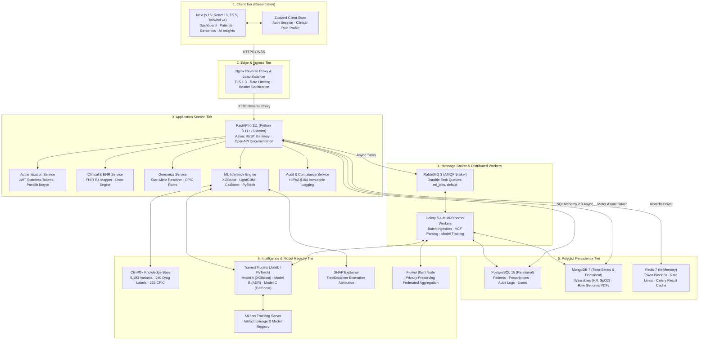

# 01. Architecture Overview & System Topology

This document details the multi-tier architectural design of **PrecisionRx AI**, tracing how requests, data flows, and clinical intelligence move through the system from the clinician interface to the underlying persistence and machine learning layers.

---

## 1. Architectural Philosophy & Clinical Mandates

PrecisionRx AI is designed as a **Clinical Decision Support System (CDSS)** specifically engineered for pharmacogenomics (PGx). In healthcare software, systems must satisfy three non-negotiable requirements:

1. **Zero-Latency Clinical Alerts (<100ms)**: When an oncologist or cardiologist is prescribing high-risk medications (e.g., Warfarin, Clopidogrel, Codeine, Fluorouracil), the system must validate the drug against patient genetics and organ function in real time.
2. **Deterministic Explainability (XAI)**: Medical providers cannot act on "black box" recommendations. Every prediction must provide exact mathematical attribution (via SHAP Shapley values and CPIC Level 1A clinical guidelines).
3. **HIPAA Security & Data Sovereignty**: Protected Health Information (PHI) must be encrypted at rest (AES-256 GCM) and in transit (TLS 1.3), with complete immutable audit logs tracking every read, write, and AI override.

---

## 2. Multi-Tier System Topology Diagram

---

## 3. End-to-End Clinical Data Lifecycles

### Flow A: Real-Time Drug-Gene Interaction & AI Prescription Triage
1. **Clinician Action**: A doctor opens Margaret Johnson's record (`/patient/p1`) and prescribes **Codeine 30mg**.
2. **API Ingestion**: Next.js sends `POST /api/v1/clinical/prescriptions/verify` to FastAPI via Nginx.
3. **Data Hydration**:
   - Patient EHR (eGFR 42, HbA1c 7.6%, Age 68) is queried asynchronously from **PostgreSQL** via `asyncpg`.
   - Genomic Profile (`CYP2D6 *4/*4` Poor Metabolizer) is retrieved from the relational model.
4. **CPIC Deterministic Rule Execution**:
   - `genomics_service.py` evaluates CPIC Level 1A guidelines for `CYP2D6` and Codeine.
   - It flags: *Poor metabolizers lack bioactivation to morphine. Complete loss of analgesia, risk of toxic metabolite diversion.*
5. **Machine Learning Model Execution**:
   - **Model B (LightGBM ADR Predictor)** computes ADR Toxicity Probability = **89%**.
   - **Model A (XGBoost Recommender)** evaluates safer alternatives (e.g., Acetaminophen, Non-opioid adjuvant).
   - **Model C (CatBoost Dosage Optimizer)** calculates recommended safe titration limits.
6. **Explainability**:
   - `shap_explainer.py` computes localized Shapley values for the patient's 57 biomarkers.
   - Identifies `CYP2D6 *4/*4` (+0.35) and `eGFR = 42` (+0.28) as the primary hazard drivers.
7. **Response & Audit**:
   - Response payload returns in **<45ms** to the frontend.
   - An immutable audit record is logged to PostgreSQL with clinician ID, timestamp, patient MRN, and decision payload.

---

### Flow B: Asynchronous Genomic VCF Ingestion & Star-Allele Translation
1. **File Upload**: A geneticist uploads a whole-exome sequencing file (`patient_sample.vcf.gz`, 250MB) on `/genomics`.
2. **Asynchronous Hand-off**:
   - FastAPI streams the payload into temporary encrypted storage and dispatches a background task `tasks.process_vcf_file(patient_id, file_path)` to **RabbitMQ**.
   - HTTP response returns immediately (`202 Accepted`, task ID: `task-7104`).
3. **Celery Worker Execution**:
   - A dedicated Celery worker picks up the job from the `ml_jobs` queue.
   - `pyvcf3` parses the raw chromosomal coordinates against GRCh38 reference positions.
   - Variants are mapped against the 8 core pharmacogenes (`CYP2D6`, `CYP2C19`, `CYP2C9`, `SLCO1B1`, `DPYD`, `HLA-B`, `TPMT`, `CYP3A4`).
   - Star-allele calling calculates the diploid activity score (e.g., `*4` [score 0] + `*4` [score 0] = Activity Score 0.0 Poor Metabolizer).
4. **Persistence & Cache Invalidation**:
   - Identified variants are saved to PostgreSQL (`genomic_profiles` table).
   - Unstructured raw metadata and variant calls are archived in MongoDB.
   - Celery posts completion to Redis; WebSocket notifies the clinician frontend to refresh metrics.

---

### Flow C: Continuous Longitudinal Wearable Telemetry & Adherence Forecasting
1. **Sensor Ingestion**: Wearable APIs (Apple HealthKit / Continuous Glucose Monitors) push high-frequency telemetry (Heart Rate every 5 seconds, SpO2 every minute, Sleep stages).
2. **Time-Series Persistence**: Handled by **MongoDB** via `motor` async driver. MongoDB's document architecture excels at variable-interval sensor data without requiring rigid schema alterations for new device models.
3. **Deep Learning Forecasting**:
   - **Model D (PyTorch Bi-Directional LSTM Attention Network)** takes a sliding 90-day window of HR, HRV, sleep metrics, and medication refill timestamps.
   - Predicts adherence decline or physiological distress 14 days before clinical manifestation.

---

## 4. Key Architectural Trade-Offs & Decisions

| Decision | Alternative Considered | Why PrecisionRx AI Chose This Design |
|---|---|---|
| **Polyglot Database (PostgreSQL + MongoDB)** | Monolithic Single DB (PostgreSQL only or Mongo only) | Relational SQL guarantees strict ACID compliance and foreign-key integrity for prescriptions and HIPAA audits; MongoDB provides the high-write throughput and schema flexibility needed for wearable telemetry and complex genomic variant JSONs. |
| **RabbitMQ + Celery Task Queue** | Synchronous API Processing or FastKafka | VCF parsing and ML retraining can take from 20 seconds to 10 minutes. Synchronous execution would exhaust HTTP socket connections and block users. RabbitMQ guarantees message durability and dead-letter queueing. |
| **FastAPI + AsyncIO** | Django / Flask / Spring Boot | Python is the undisputed lingua franca of machine learning (XGBoost, CatBoost, PyTorch). FastAPI provides native asynchronous concurrency (`async`/`await`), auto-generated OpenAPI 3.1 documentation, and Pydantic validation at C-like speeds. |
| **Stateless JWT with Redis Blacklisting** | Server-Side Stateful Sessions | Allows horizontal scaling of API nodes behind Nginx without sticky sessions, while Redis gives instant revocation capability during clinician logout or privilege escalation. |
| **Federated Learning (Flower)** | Centralized Cloud Training | Hospital networks are legally prohibited under HIPAA and GDPR from pooling raw genomic sequences in a single cloud database. Flower enables collaborative model training by exchanging only encrypted gradient updates. |
